<a href="https://pedrassolli.vercel.app">
  <picture>
    <source media="(prefers-color-scheme: dark)" srcset="https://raw.githubusercontent.com/PedroPedrassolli/PedroPedrassolli/main/assets/banner-dark.svg">
    <source media="(prefers-color-scheme: light)" srcset="https://raw.githubusercontent.com/PedroPedrassolli/PedroPedrassolli/main/assets/banner-light.svg">
    
  </picture>
</a>

  I'm happiest when I can take a messy business rule, make sense of it, and turn it into code that's boring in the best way: clear, tested, and easy to change. Most days that means Rails, SQL, and the occasional legacy mystery. ☕

  <a href="https://pedrassolli.vercel.app"><b>Portfolio</b></a> &nbsp;·&nbsp;
  <a href="https://www.linkedin.com/in/pedro-pedrassolli-97b636162">LinkedIn</a> &nbsp;·&nbsp;
  <a href="mailto:pedrassolli.software@gmail.com">Email</a> &nbsp;·&nbsp;
  <a href="https://github.com/pedro-emottasistemas">Work GitHub</a>

## Projects

<a href="https://pedrassolli.vercel.app">
  <picture>
    <source media="(prefers-color-scheme: dark)" srcset="https://raw.githubusercontent.com/PedroPedrassolli/PedroPedrassolli/main/assets/portfolio-dark.svg">
    <source media="(prefers-color-scheme: light)" srcset="https://raw.githubusercontent.com/PedroPedrassolli/PedroPedrassolli/main/assets/portfolio-light.svg">
    
  </picture>
</a>

  <a href="https://github.com/PedroPedrassolli/br_validators"><picture>
    <source media="(prefers-color-scheme: dark)" srcset="https://raw.githubusercontent.com/PedroPedrassolli/PedroPedrassolli/main/assets/br-validators-dark.svg">
    <source media="(prefers-color-scheme: light)" srcset="https://raw.githubusercontent.com/PedroPedrassolli/PedroPedrassolli/main/assets/br-validators-light.svg">
    
  </picture></a>
  <a href="https://github.com/PedroPedrassolli/simples-nacional"><picture>
    <source media="(prefers-color-scheme: dark)" srcset="https://raw.githubusercontent.com/PedroPedrassolli/PedroPedrassolli/main/assets/simples-nacional-dark.svg">
    <source media="(prefers-color-scheme: light)" srcset="https://raw.githubusercontent.com/PedroPedrassolli/PedroPedrassolli/main/assets/simples-nacional-light.svg">
    
  </picture></a>

  Try them live: <a href="https://br-validators.vercel.app">br_validators test page</a> · <a href="https://rubygems.org/gems/br_validators">br_validators on RubyGems</a> · <a href="https://simples-nacional-br.vercel.app">Simples Nacional calculator</a>

## Things I like working with

  <picture>
    <source media="(prefers-color-scheme: light)" srcset="https://skillicons.dev/icons?i=ruby,rails,react,js,html,css,postgres,mysql,redis&amp;perline=9&amp;theme=light">
    
  </picture>

RSpec keeps the weird edge cases honest.

## Where the code lives

I keep work and personal commits in separate accounts:

- **Personal** · [@PedroPedrassolli](https://github.com/PedroPedrassolli): this profile, my portfolio and open-source side projects.
- **Work** · [@pedro-emottasistemas](https://github.com/pedro-emottasistemas): day-to-day work at Emotta Sistemas.

Less magic. More clarity. Test the weird cases.

